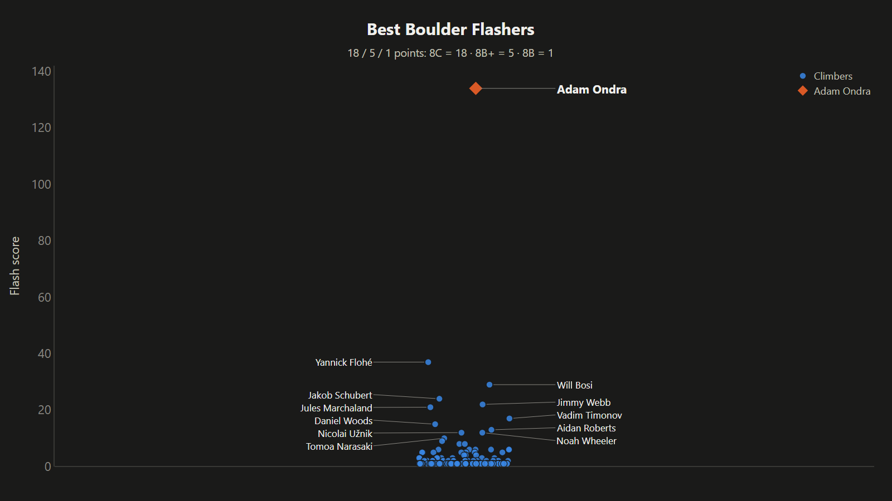
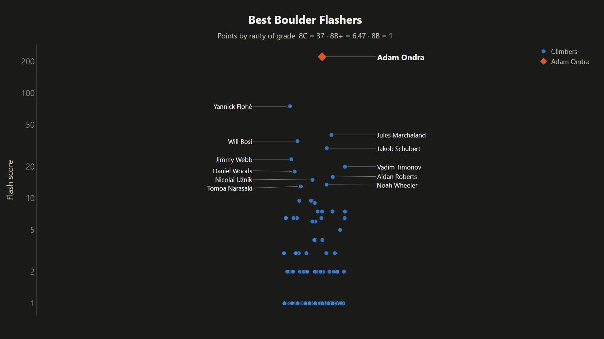
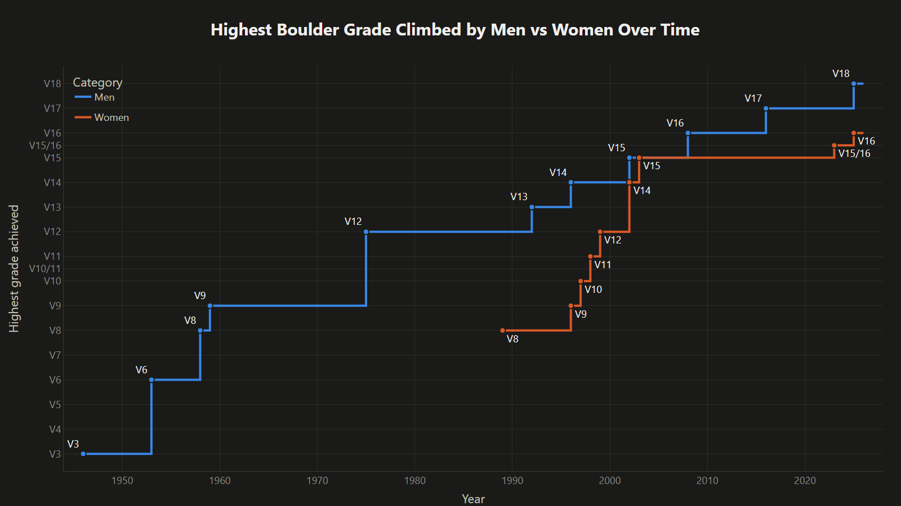
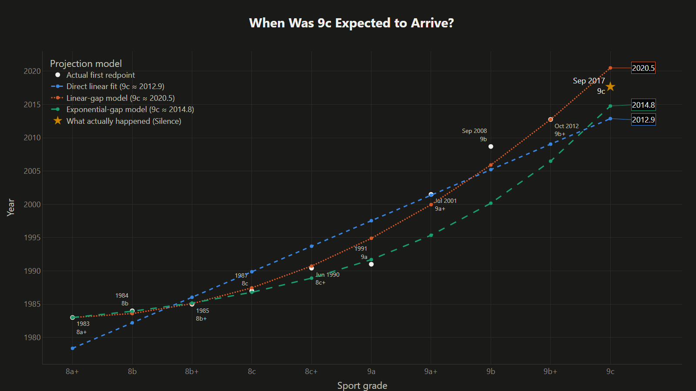

# Climbing Graphs

Who are the best climbers in the world, and how fast are grades progressing?
This repo has the code behind these two videos:

- **[He can't keep getting away with this...](https://www.youtube.com/watch?v=wFZ_-d0vKNA)**: best boulder flasher, boulderer, sport climber, onsighter and competition climber; men vs women grades; flash vs redpoint grades.
- **[I fixed my broken climbing graphs...](https://youtu.be/Hf0kpQDH4I4)**: the follow-up with the alternative scoring systems described below.



## Scoring systems

Each "best climber" chart ranks climbers by their ascents in a list of the
hardest climbs. Every ascent earns points based on its grade, and a climber's
score is the sum. The four scoring systems differ only in how many points each
grade is worth:

| Scheme | Hardest grade | 2nd hardest | 3rd hardest | Idea |
|---|---|---|---|---|
| `exponential` (main video) | 18 | 5 | 1 | Each grade is roughly 5x harder than the one below, which gives 25 / 5 / 1. The top grade is reduced from 25 to 18 because the hardest grades are the least settled. |
| `conservative` | 4 | 2 | 1 | Each grade is only 2x harder than the one below. |
| `rarity` | *N* / ascents of it | *N* / ascents of it | 1 | Based on the number of ascents at each grade: a grade climbed 7 times is worth 259/7 = 37 points if the easiest grade was climbed 259 times. The data sets the exchange rate between grades, not a guess. |
| `equal` | 1 | 1 | 1 | A plain count of hard ascents. |

(*N* = number of ascents of the easiest grade in the list.) Grades are ranked
separately within each list, so for flashes "hardest" means 8C, and for sport
redpoints it means 9c. The onsight list has only two grades (9a and 8c+), so
they get the top two values (18 and 5 in the main scheme).

The rarity scores cover two orders of magnitude, so those charts use a log axis.



## Setup

Requires Python 3.10+.

```bash
git clone https://github.com/joeykang21-arch/climbing-graphs.git
cd climbing-graphs
pip install -e ".[dev]"
```

## Usage

Every chart is written as an interactive HTML file to `output/`. Add `--show`
to open it in your browser as well.

```bash
python -m climbing_graphs all                      # every chart (37 files)

# Best climbers: flashes | boulder | sport | onsights | all
python -m climbing_graphs best flashes             # 18/5/1 scoring
python -m climbing_graphs best flashes --scheme rarity
python -m climbing_graphs best all --scheme all    # every list x every scoring system
python -m climbing_graphs best boulder --highlight "Elias Iagnemma" --top 15
python -m climbing_graphs best flashes --as-of 2026-02-24   # rankings as they stood on a date

# Competition wins (lead + boulder + combined, no speed)
python -m climbing_graphs comp men
python -m climbing_graphs comp women

# Hardest grade over time, plus the gap between the two lines
python -m climbing_graphs frontier sport-gender    # also: boulder-gender, flash-gender, sport-style, boulder-style

# "When will the next grade happen?"
python -m climbing_graphs projection boulder-v19   # see --help for all projections

python -m climbing_graphs timeline                 # animated build-up of every 8C+ and harder ascent
python -m climbing_graphs thumbnail                # video thumbnail (illustrative, not real data)
```

Other options: `--label NAME` (always label a climber), `--background image.jpg`
(image behind the plot), `--log` / `--linear` (force the score axis),
`--refresh` (re-download the source pages), `--out DIR`.

Run `python -m climbing_graphs <command> --help` for the details of each command.

Downloaded pages are cached in `.cache/` for a day. If a download fails, the
last cached copy is used.

### From a notebook

```python
from climbing_graphs.scoring import CATEGORIES, SCHEMES, score_climbers
from climbing_graphs.sources import read_ascent_list

flashes = CATEGORIES["flashes"]
ranking = score_climbers(read_ascent_list(flashes.url), SCHEMES["rarity"], flashes.scale)
ranking.table.head(10)
```

## Charts

**Best climbers** (`best`, `comp`): each dot is a climber, plotted at the
height of their score. The horizontal position is random and means nothing.
The top 12 names are labelled.

**Frontiers** (`frontier`): the hardest grade achieved each year by two groups
(men vs women, or redpoint vs flash), plus a chart of the gap between them.



**Projections** (`projection`): when will the next grade fall? Three models are
fitted to the dates each grade was first climbed:

- *Direct linear fit*: year is a straight line in grade.
- *Linear-gap model*: the wait between grades grows by a fixed amount each grade.
- *Exponential-gap model*: the wait between grades grows by a fixed factor each grade.

The `sport-9c-hindcast` projection fits only the grades up to 9b+ and then shows
when 9c actually happened (Silence, 2017).



## Data

| Data | Source |
|---|---|
| Hard boulder flashes, hard boulder ascents, hard sport ascents, hard onsights | [climbing-history.org](https://climbing-history.org) lists 20, 14, 5 and 37 (downloaded live) |
| IFSC career wins | [Wikipedia: Ranking of career IFSC victories by climber](https://en.wikipedia.org/wiki/Ranking_of_career_IFSC_victories_by_climber) (downloaded live) |
| First ascents of each grade (frontiers and projections) | Hand-curated in [`climbing_graphs/milestones.py`](climbing_graphs/milestones.py). Edits and corrections are welcome. |

Ascent dates such as "Before 25th Feb 2008" or "9th-10th March 2025" resolve to
the earliest date they could mean.

## Project layout

```
climbing_graphs/
  cli.py           command-line entry point
  scoring.py       scoring systems and the four ranked lists
  sources.py       downloading, caching and parsing source tables
  grades.py        grade scales (French sport, Font, V) and normalization
  dates.py         parsing free-form ascent dates
  milestones.py    curated first-ascent-of-grade data
  frontier.py      hardest-grade-so-far series and gaps
  projections.py   the three projection models
  labels.py        automatic non-overlapping label placement
  theme.py         shared colours, layout and HTML export
  charts/          one module per chart type
tests/             offline unit tests (pytest)
```

Run the tests with `pytest`.

## Changes since the videos

The video graphs came from Jupyter notebooks (preserved in this repo's first
commit). Moving them into this package fixed several problems:

- **Men's and women's competition charts were swapped.** Wikipedia reordered its tables, and the notebooks picked them by position. Tables are now found by their section heading.
- **Grade steps were miscounted in projections.** When the data skipped a grade (no known men's 8a+ flash/onsight), the gap models were fitted against the wrong steps. The free-solo grade list also skipped 7b+ and 7c+, so 7b→7c→8a counted as two steps instead of four. Projections now use real grade positions.
- **Free-solo projection.** Some grades were soloed before easier ones (7a+ in 1961, 7a in 1978), which gave the exponential model negative gaps. Milestones beaten by an earlier, harder ascent are now left out of the fit.
- **First V16.** The frontier chart used Gioia (2008) but the projection used Hypnotized Minds (2010). Both now use Gioia, the earliest 8C+ on climbing-history.org.
- **Manual adjustments removed.** The flash chart added 18 points to Adam Ondra by hand (for an 8C flash not yet listed at the time) and filtered out specific climbs. That ascent is now listed, so the adjustment would double-count it. Use `--as-of DATE` to reproduce a chart as it stood on a given date.
- **Points for grades outside the top three.** One notebook gave 1 point for 8C+ flashes, which aren't in the list. Points now go to the top three grades actually present in each list.
- **Labels are placed automatically** instead of hand-nudging individual names, so charts stay readable as the data changes.
- **Date parsing** handles ranges like "9th-10th March 2025" and returns no date for unparseable text instead of crashing.
- **Background images are embedded** instead of being linked from a local Downloads path that didn't work outside one machine.
- **HTML files load plotly.js from a CDN**, so most are ~20 KB instead of ~5 MB (the animated timeline is ~1 MB). Viewing them needs an internet connection.
